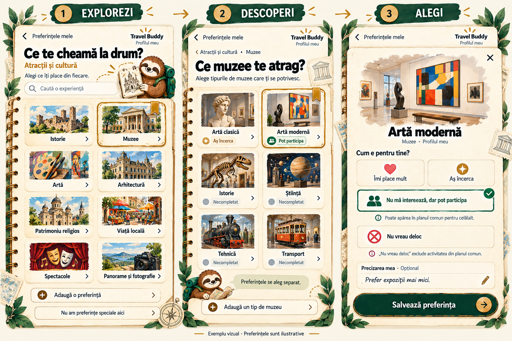
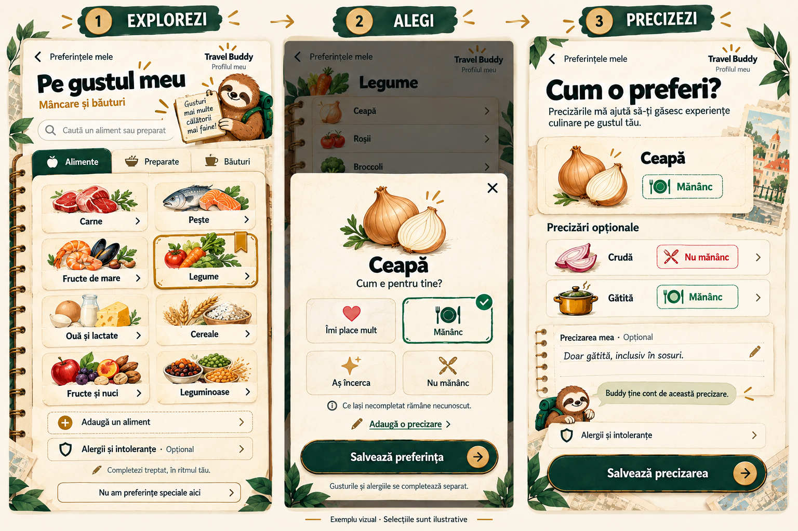
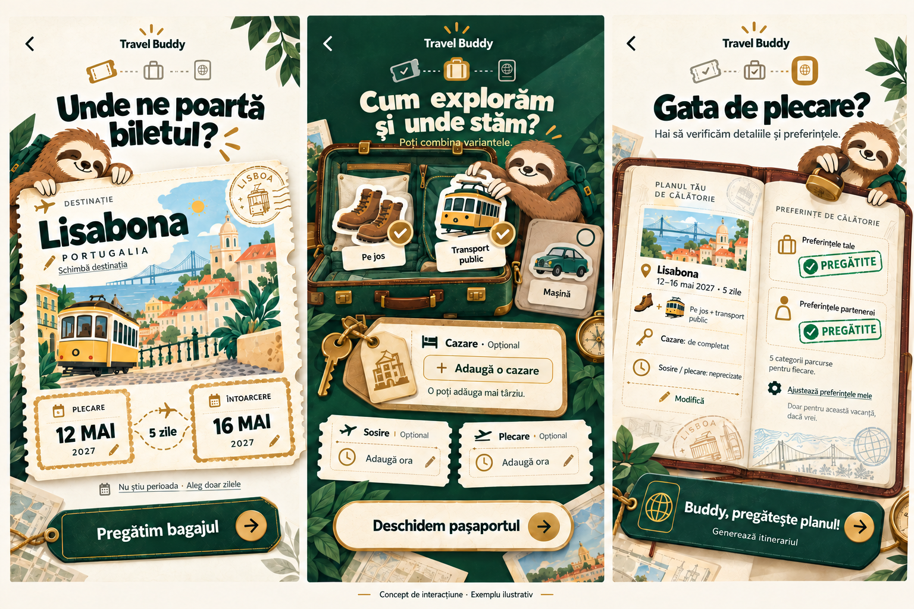
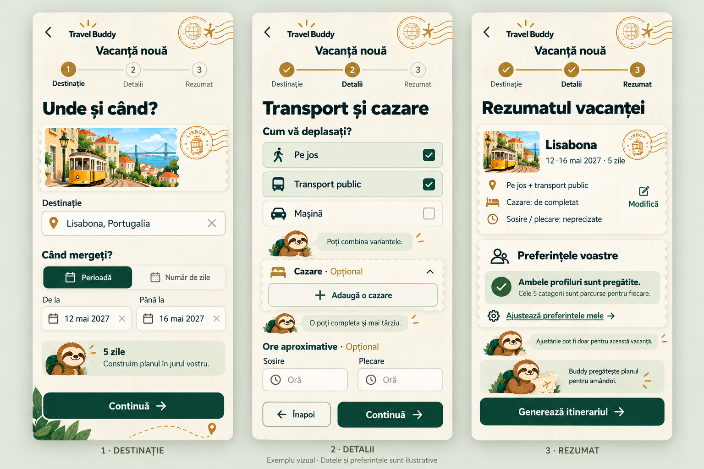
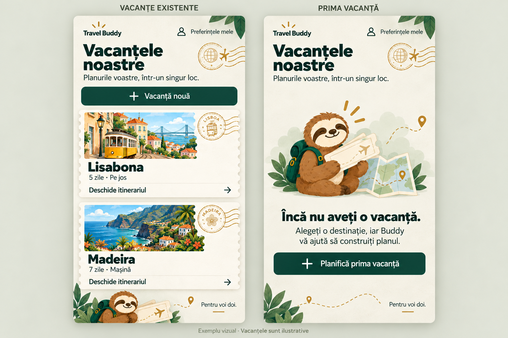
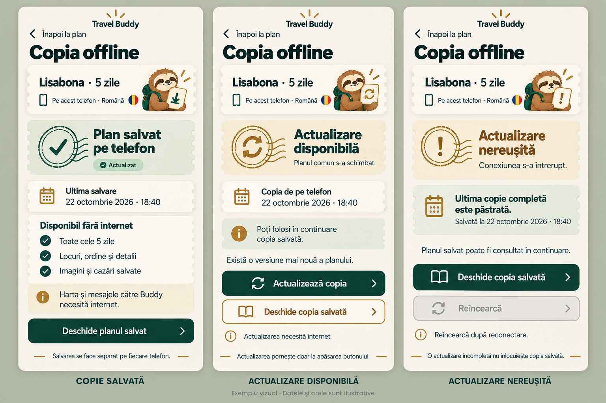
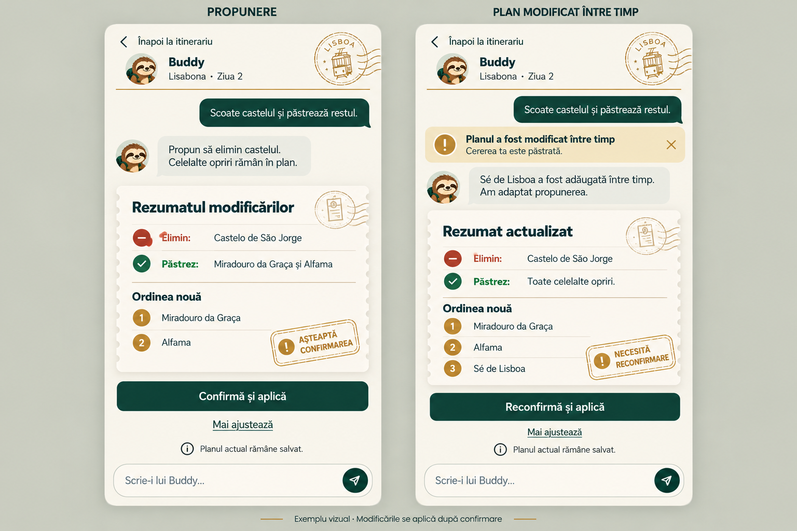

# Machete Travel Buddy

## Atracții și cultură — carnet de explorator, feedback vizual pozitiv
2026-10-23. Trei vederi succesive ale propriilor preferințe, în stilul carnetului de gusturi aprobat.

### Ce arată
- Grupele culturale deja aprobate, cu căutare și adăugarea unei preferințe.
- Tipuri concrete de muzee, selectate separat: artă clasică, artă modernă, istorie, știință, tehnică și transport.
- Patru răspunsuri pentru o activitate exactă, cu distincția dintre participarea fără interes propriu și refuzul explicit.
- Nota opțională a persoanei și salvarea alegerii în propriul profil.

**Stare:** feedback vizual pozitiv de la utilizator („super”); aspectul poate fi folosit ca reper pentru continuare. Exemplul „Artă modernă — Nu mă interesează, dar pot participa” și nota sunt ilustrative. Nu sunt declarații despre utilizatori sau preferințe efectiv salvate.
Regula rămâne cea aprobată: refuzul explicit al oricăruia exclude activitatea comună; disponibilitatea de participare permite echilibrarea intereselor celor doi. Nu se introduce implicit timp separat.
Fontul real, accesibilitatea, persistența și claritatea se verifică ulterior în site-ul funcțional. Nu există formular sau recomandări implementate.

## Preferințe alimentare — carnet de gusturi, aprobat vizual
2026-10-23. Trei vederi succesive ale propriului profil, cu selecții concrete și precizări opționale.

### Ce arată
- Filele **Alimente / Preparate / Băuturi**, căutarea directă și grupele ilustrate; inventarul este extensibil.
- Alegerea exclusivă a unuia dintre cele patru răspunsuri aprobate pentru un element exact.
- Exemplul „Ceapă”: „Mănânc”, cu excepția „Crudă — Nu mănânc” și acceptul „Gătită — Mănânc”.
- Precizare proprie opțională, alimente necompletate tratate ca necunoscute și alergii/intoleranțe separate.
- Opțiunea „Nu am preferințe speciale aici”, fără obligarea parcurgerii fiecărui aliment.

**Stare:** machetă aprobată vizual de utilizator („da, îmi place, e fun”). Selecțiile și nota sunt exemple, nu date reale ale celor doi. Ingredientele și preparatele sunt tratate distinct; alegerea unui ingredient nu aprobă automat toate rețetele care îl includ.
Băuturile folosesc același mecanism pe elemente exacte; imaginea arată fila de acces, nu inventarul complet de băuturi. Cerința celor cinci categorii parcurse de fiecare persoană rămâne valabilă, fără obligația completării fiecărui aliment.
Bricolage Grotesque rămâne fontul stabilit. Interacțiunile, persistența, accesibilitatea și claritatea se verifică ulterior în site-ul funcțional; macheta nu este un formular implementat.

## Crearea vacanței — „Bilet, bagaj, pașaport”, propunere nouă
2026-10-23. Alternativă cerută de utilizator după respingerea meniurilor generice din prima machetă. Schimbă compoziția și propune interacțiuni pe obiecte de călătorie, păstrând datele și opțiunile necesare.

### Experiența propusă
- **Bilet:** orașul și datele devin zone editabile pe biletul ilustrat al destinației; există alternativa cu număr de zile.
- **Bagaj:** atingerea jetoanelor selectează transportul; combinațiile sunt vizibile prin marcaje, iar cazarea și orele rămân opționale, pe etichete.
- **Pașaport:** datele și cele două profiluri pregătite sunt revizuite înainte de acțiunea explicită de generare.

### Mișcări propuse pentru implementare
- Jetoanele alese se așază în bagaj.
- Pașaportul preia alegerile și arată starea fiecărui profil.
- Acțiunea finală face tranziția către ecranul de generare aprobat.
Aceste animații nu există încă. Atingerea/butoanele rămân suficiente; nu se cere tragere obligatorie, precizie de joc sau gesturi speciale.

**Stare:** scenele a doua (transport / cazare) și a treia (pașaportul / rezumatul) sunt aprobate vizual de utilizator. Titlul „Cum explorăm și unde stăm?” este aprobat explicit la 2026-10-23. Prima scenă nu are o confirmare explicită separată. La cererea utilizatorului, titlul scenei a doua a fost schimbat din „Ce luăm în călătorie?” în „Cum explorăm și unde stăm?”, pentru a descrie transportul și cazarea; ultima scenă este păstrată. Noua formulare este aprobată; mișcările rămân propuneri pentru implementare. Datele, rezervările și profilurile sunt exemple; nu există interacțiuni funcționale. Cerințele pentru preferințe, mai multe cazări, lipsa bugetului și ore opționale rămân în `product.md`. Bricolage Grotesque este fontul stabilit, cu redarea exactă de verificat în browser.
Prima machetă este păstrată mai jos ca istoric, fără a fi tratată ca design aprobat.

## Istoric — creare în trei pași, prima machetă neacceptată
2026-10-23. Propunere de grupare a formularului cerut în trei ecrane succesive.

### Ce arată
1. **Destinație:** destinația, opțiunea perioadă/număr de zile și ilustrația personalizată.
2. **Detalii:** transport combinabil, cazare opțională și ore aproximative opționale de sosire/plecare.
3. **Rezumat:** datele alese, pregătirea preferințelor amândurora, ajustarea preferințelor proprii și pornirea generării.

**Stare:** prima machetă nu a fost acceptată vizual. Utilizatorul consideră experiența prea generică și cere o direcție mai distractivă și creativă. Cerința unui flux în trei pași rămâne aprobată. În produs ecranele sunt succesive, nu trei coloane simultane.
Lisabona, 12–16 mai 2027 (cinci zile inclusiv), transportul combinat și profilurile pregătite sunt exemple. Nu există date personale completate. Cazarea și orele sunt lăsate necompletate; bugetul nu este cerut. Ilustrația este de design, iar fidelitatea fontului Bricolage Grotesque se verifică în browser.
Cele cinci categorii de preferințe trebuie parcurse de fiecare persoană conform regulii existente; ecranul trei arată doar exemplul ambelor profiluri pregătite. Cazările/bazele multiple rămân în cerințe, chiar dacă macheta arată doar intrarea „Adaugă o cazare”.
Nu există formular funcțional. Scenariile de verificare sunt în `verification.md`, încă neexecutate.

## „Vacanțele noastre” pe telefon — aprobată vizual
2026-10-22. Pagina privată de după conectare, cu două stări alternative ale aceluiași ecran mobil.

### Ce arată
- **Vacanțe existente:** carduri cu destinație, imagine ilustrativă, număr de zile, transport și „Deschide itinerariul”; buton „Vacanță nouă”.
- **Prima vacanță:** mesaj introductiv și „Planifică prima vacanță”, cu Buddy mai vizibil.
- „Preferințele mele” în ambele stări, pentru contul conectat.
- Bilete, ștampile și paleta aprobată; Buddy discret lângă lista de vacanțe.

**Stare:** cele două stări sunt aprobate vizual la 2026-10-23. Utilizatorul apreciază explicit imaginile specifice fiecărei destinații; această direcție se păstrează pe cardurile vacanțelor, în același stil ilustrat. Lisabona / 5 zile / pe jos și Madeira / 7 zile / mașină sunt exemple pentru design, nu date personale sau călătorii reale salvate. Cele două stări nu apar simultan în produs. Miniaturile sunt ilustrative, nu fotografii confirmate din surse.
Fontul real, dimensiunile pe telefon și comportamentul paginii se verifică la implementare. Nu există pagină funcțională sau autentificare implementată.
Fluxul de creare în trei pași este reprezentat separat în macheta de mai sus.

## Copia offline pe telefon — trei stări, aprobate vizual
2026-10-22. Machetă statică în direcția vizuală aprobată, cu trei stări ale aceluiași ecran mobil.

### Ce arată
- **Copie salvată:** telefonul, limba, data salvării, o sinteză a conținutului disponibil și acces la plan.
- **Actualizare disponibilă:** schimbări în planul comun, buton pentru actualizare manuală și acces în continuare la copia salvată.
- **Actualizare nereușită:** explicația întreruperii conexiunii, păstrarea ultimei copii complete cu aceeași dată și acces la plan; reîncercarea este dezactivată până la reconectare.
- Harta și mesajele către Buddy necesită internet. Fiecare telefon își salvează separat copia.

**Stare:** machetă aprobată vizual de utilizator („foarte bine, mai departe”). Claritatea și comportamentul real se verifică în site-ul funcțional, potrivit cererii utilizatorului; scenariile sunt în `verification.md`, încă neexecutate.
Datele sunt ilustrative: Lisabona, 5 zile, română, 22 octombrie 2026 · 18:40 (Europe/Bucharest). Nu există salvare reală și această imagine nu dovedește persistența sau funcționarea offline. Rândurile despre conținut sunt o sinteză și nu înlocuiesc lista aprobată din `product.md`.
Fontul real și accesibilitatea se verifică la implementare.

## Conversația cu Buddy — machetă aprobată vizual
2026-10-22. Machetă statică în direcția vizuală aprobată, prezentând două stări alternative ale aceluiași ecran mobil.

### Ce arată
- **Stânga:** cererea de eliminare a castelului, rezumatul a ceea ce se elimină și se păstrează, ordinea propusă și „Confirmă și aplică”.
- **Dreapta:** „Planul a fost modificat între timp”, cererea păstrată, un loc nou păstrat în propunerea adaptată și „Reconfirmă și aplică”.
- Planul actual rămâne salvat până la confirmare. O singură persoană poate confirma; nu există o cerință de aprobare dublă.
- „Mai ajustează”, scrierea unui mesaj și revenirea la itinerariu.
- Buddy discret, rezumat pe bilet de călătorie, ștampile de stare și paleta aprobată.

**Stare:** aspect aprobat vizual de utilizator. Claritatea fluxului va fi evaluată în etapa de verificare, când site-ul este funcțional; nu este validată prin această imagine. Scenariile sunt în `verification.md`, neexecutate. Mesajele și locurile sunt exemple de design, nu o conversație sau modificări reale. Schimbarea comună ilustrată constă în adăugarea Sé de Lisboa; aceasta rămâne în propunerea actualizată, în timp ce numai castelul este eliminat. După confirmare trebuie reverificată actualitatea propunerii conform cerinței existente.

Fontul real, lizibilitatea la dimensiuni de telefon, accesibilitatea, păstrarea cererii și gestionarea schimbărilor simultane se verifică la implementare. Imaginea nu este un chat funcțional și nu demonstrează sincronizarea.

## Detaliile unui loc pe telefon — machetă aprobată
2026-10-22. Panou cu detaliile unei opriri, deschis peste itinerariu, în direcția vizuală aprobată.

### Ce arată
- Contextul zilei și numărul opririi, imagine ilustrativă, numele și descrierea locului.
- Motivul recomandării, cu Buddy discret.
- Preț / Program — Neconfirmat; Rezervare — De verificat.
- Acces la sursă, înlocuirea sau eliminarea locului și revenirea la itinerariu.
- Închidere prin X sau „Înapoi la plan”, cu păstrarea poziției și a stării listei/hărții conform cerinței existente.

**Stare:** machetă aprobată de utilizator: „da, arată bine și este în temă”. Organizarea panoului și direcția vizuală sunt acceptate. Exemplul nu constituie informații turistice verificate sau declarații despre profilurile celor doi. Imaginea este ilustrativă; datele lipsă rămân marcate. „Vezi sursa” este un control de design fără link funcțional în această machetă. Fontul real, lizibilitatea la dimensiuni reale, accesibilitatea, revenirea la poziție și acțiunile se verifică la implementare. Nu există ecran funcțional.

## Itinerariul unei zile pe telefon — Listă și Hartă, pentru evaluare
2026-10-22. Machetă statică realizată la cererea utilizatorului, folosind direcția vizuală aprobată a combinației 2 + 3.

### Ce arată
- O singură zi selectată, cu comutare între Listă și Hartă pe telefon. Cele două stări sunt alăturate doar în această planșă de design.
- Aceleași trei opriri în ambele stări, în ordinea Miradouro da Graça → Castelo de São Jorge → Alfama.
- Traseul schematic pornește și revine la Centru, punctul implicit fără cazare. Au fost verificate vizual legăturile și sensul Centru → 1 → 2 → 3 → Centru.
- Prețuri marcate neconfirmate, acces la detalii, cafenele opționale separate de opriri.
- Adăugarea unui loc, salvarea planului offline și acces la Buddy. Harta este online; butonul de salvare se referă la planul consultabil offline.
- Buddy discret și accente de bilete/ștampile, în paleta aprobată.

**Stare:** utilizatorul a apreciat aspectul („Îmi place cum arată”) și a cerut continuarea. „Lisabona · 5 zile · Pe jos”, ziua și opririle sunt exemple. Miniaturile și harta sunt ilustrative; nu sunt fotografii licențiate ori date cartografice verificate. Nu se prezintă prețuri reale inventate, ore, distanțe sau durate. Numărul de trei opriri este doar exemplul desenat, nu o limită a produsului.

Fontul stabilit rămâne Bricolage Grotesque. Tipografia exactă, contrastul, dimensiunile reale, adaptarea și comportamentul interactiv se verifică în browser la implementare. Nu există ecran funcțional, hartă integrată sau salvare offline implementată.

## Direcție aprobată — combinația 2 + 3
2026-10-22. Utilizatorul preferă variantele 2 („Pașaport cu ștampile”) și 3 („Atelierul lui Buddy”). Pornind de la ele, această explorare combină:
- Atmosfera de pașaport, bilete, perforații și ștampile din 2.
- Buddy organizând cartonașele zilelor pe masa verde din 3.
- Progresul cu trei stări lizibile, pe o foaie de pașaport cu text drept: locuri găsite, organizarea zilelor activă, verificarea în așteptare.

**Stare:** direcție vizuală aprobată explicit de utilizator: „arată grozav, exact direcția dorită”. Această machetă este referința vizuală pentru generare și pentru continuarea designului. Sunt aprobate atmosfera de pașaport, biletele/ștampilele, Buddy organizând cartonașele și prezentarea clară a progresului. Bricolage Grotesque rămâne fontul stabilit; redarea exactă necesită folosirea fontului real în browser. Imagine statică, exemplu Lisabona / 5 zile; animația și site-ul nu sunt implementate.

## Cinci iterații mai jucăușe — pentru evaluare
2026-10-22. Prima machetă nu a fost acceptată. Utilizatorul a cerut cinci alternative, păstrând baza produsului și explorând o direcție mai jucăușă.

Fontul stabilit rămâne **Bricolage Grotesque**. Imaginile sunt concepte generate: nu constituie dovada folosirii fișierului real al fontului. Fidelitatea tipografiei se verifică în browser. Baza păstrată: verde pădure, alb cald, auriu, Buddy maro/crem cu rucsac verde, trei stări de progres ușor de înțeles. „Lisabona · 5 zile” este doar exemplul ilustrat.

Toate cele cinci variante de mai jos sunt propuneri neaprobate. Sunt machete statice, fără site ori animație implementată.

### 1 — Traseu cu opriri
Traseu punctat cu opriri, cartonașe și Buddy în mișcare; progresul urmărește vizual o mică călătorie.

### 2 — Pașaport cu ștampile
Bilete, ștampile și foi de pașaport; Buddy pregătește documentele călătoriei.

### 3 — Atelierul lui Buddy
Buddy organizează cartonașele zilelor într-un mic atelier; etapele sunt grupate într-un panou clar.

### 4 — Hartă de buzunar
Fundal verde pădure, hartă pliată și zonă alb cald pentru progres; contrast mai pronunțat.

### 5 — Bagaj de vacanță
Buddy pregătește un bagaj cu elementele planului; progresul rămâne într-o listă verticală.

---

## Istoric — prima machetă, neacceptată
2026-10-22. Machetă statică generată pentru evaluare vizuală; nu este un ecran funcțional.

### Ce prezintă
- Paleta verde pădure, alb cald și auriu.
- Buddy maro/crem cu rucsac verde, pregătind cartonașe cu locuri.
- O etapă de căutare încheiată, organizarea pe zile activă, verificarea în așteptare.
- Exemplul „Lisabona · 5 zile”, fără procente sau durate estimate.
- Mesaje în română și o ilustrare statică a indicatorului de activitate.

### Stare
Direcția vizuală și comportamentul sunt aprobate. Această randare, compoziția și varianta mascotei nu au fost acceptate de utilizator, care a cerut cinci iterații mai jucăușe păstrând baza. Animația nu a fost produsă; caracterele și fontul exact, contrastul, adaptarea la dimensiuni reale de telefon și accesibilitatea se verifică ulterior în browser. Imaginea nu înlocuiește cele două fotografii Lisabona aprobate pentru introducere, ale căror referințe exacte rămân de recuperat.
