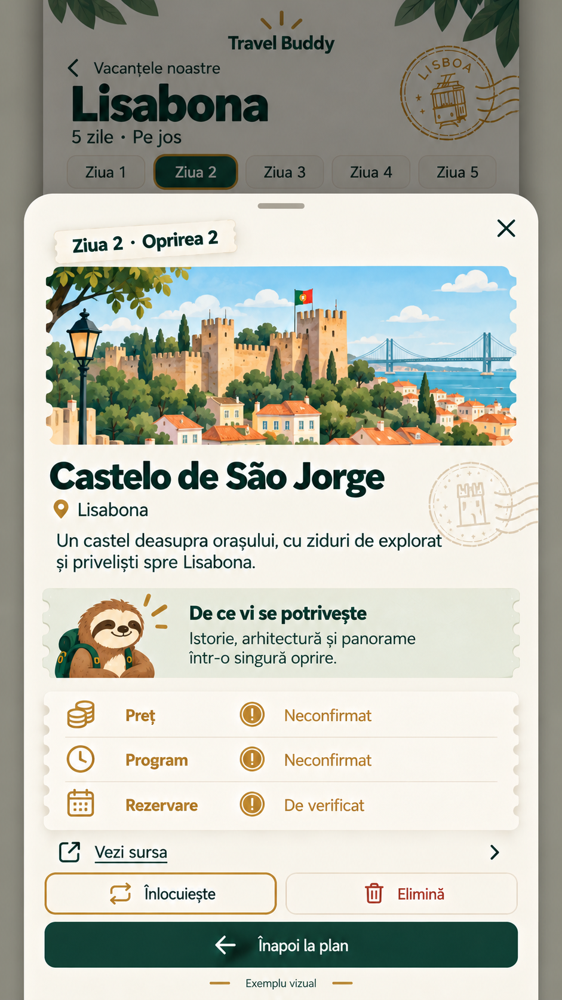
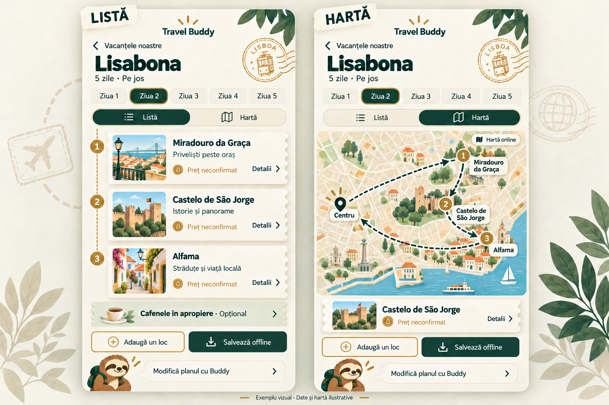
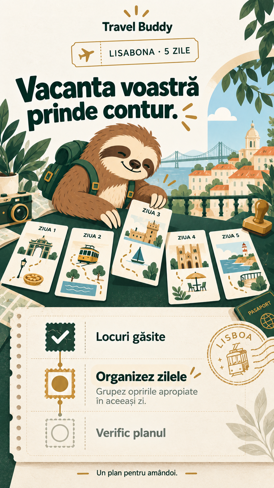
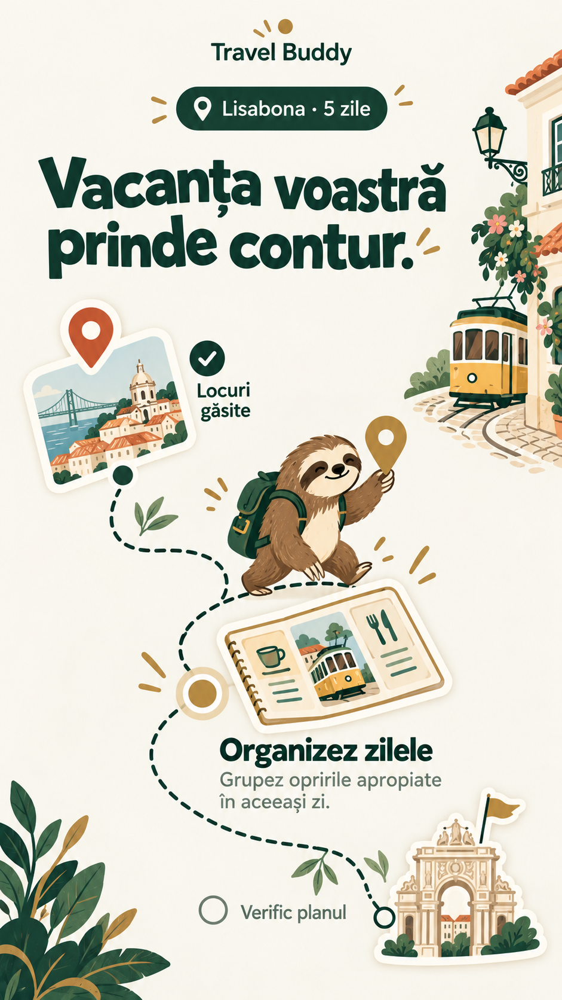
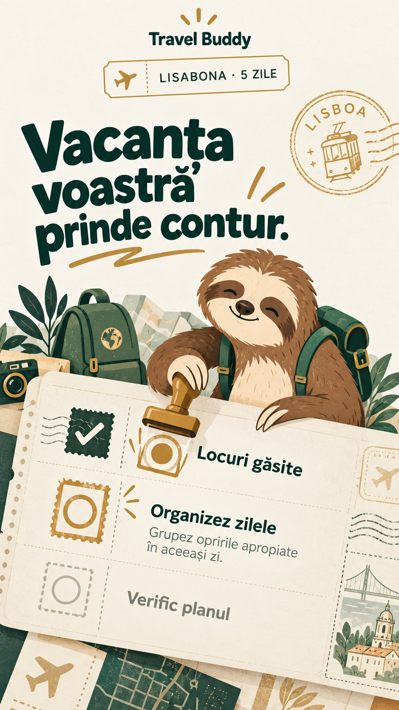
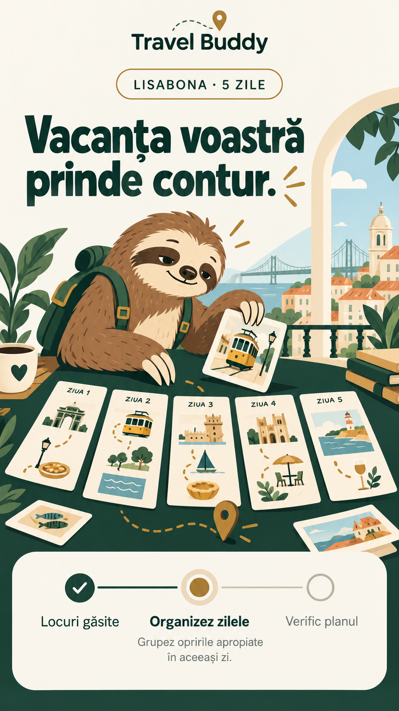
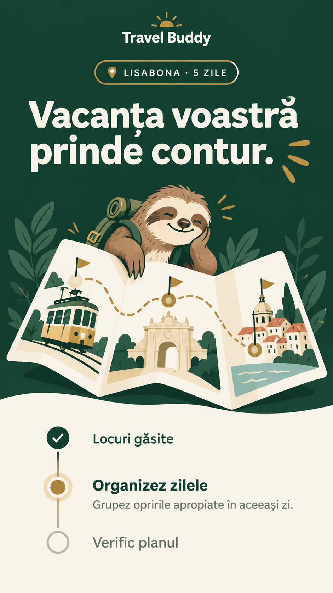
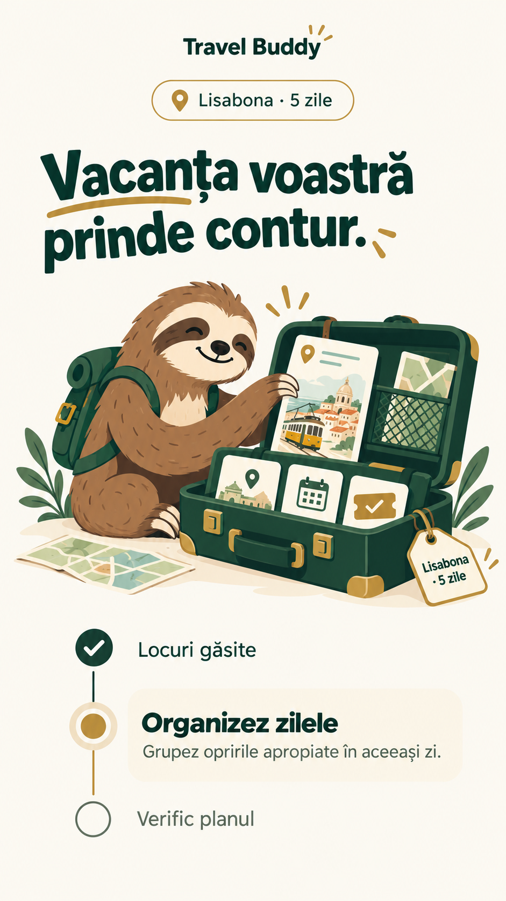
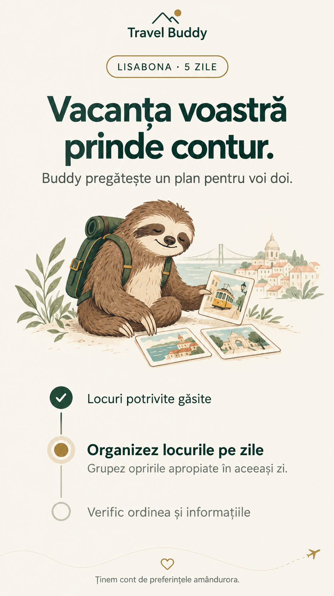

# Machete Travel Buddy

## Detaliile unui loc pe telefon — pentru evaluare
2026-10-22. Panou cu detaliile unei opriri, deschis peste itinerariu, în direcția vizuală aprobată.

### Ce arată
- Contextul zilei și numărul opririi, imagine ilustrativă, numele și descrierea locului.
- Motivul recomandării, cu Buddy discret.
- Preț / Program — Neconfirmat; Rezervare — De verificat.
- Acces la sursă, înlocuirea sau eliminarea locului și revenirea la itinerariu.
- Închidere prin X sau „Înapoi la plan”, cu păstrarea poziției și a stării listei/hărții conform cerinței existente.

**Stare:** propunere neaprobată, de evaluat. Exemplul nu constituie informații turistice verificate sau declarații despre profilurile celor doi. Imaginea este ilustrativă; datele lipsă rămân marcate. „Vezi sursa” este un control de design fără link funcțional în această machetă. Fontul real, lizibilitatea la dimensiuni reale, accesibilitatea, revenirea la poziție și acțiunile se verifică la implementare. Nu există ecran funcțional.

## Itinerariul unei zile pe telefon — Listă și Hartă, pentru evaluare
2026-10-22. Machetă statică realizată la cererea utilizatorului, folosind direcția vizuală aprobată a combinației 2 + 3.

### Ce arată
- O singură zi selectată, cu comutare între Listă și Hartă pe telefon. Cele două stări sunt alăturate doar în această planșă de design.
- Aceleași trei opriri în ambele stări, în ordinea Miradouro da Graça → Castelo de São Jorge → Alfama.
- Traseul schematic pornește și revine la Centru, punctul implicit fără cazare. Au fost verificate vizual legăturile și sensul Centru → 1 → 2 → 3 → Centru.
- Prețuri marcate neconfirmate, acces la detalii, cafenele opționale separate de opriri.
- Adăugarea unui loc, salvarea planului offline și acces la Buddy. Harta este online; butonul de salvare se referă la planul consultabil offline.
- Buddy discret și accente de bilete/ștampile, în paleta aprobată.

**Stare:** utilizatorul a apreciat aspectul („Îmi place cum arată”) și a cerut continuarea. „Lisabona · 5 zile · Pe jos”, ziua și opririle sunt exemple. Miniaturile și harta sunt ilustrative; nu sunt fotografii licențiate ori date cartografice verificate. Nu se prezintă prețuri reale inventate, ore, distanțe sau durate. Numărul de trei opriri este doar exemplul desenat, nu o limită a produsului.

Fontul stabilit rămâne Bricolage Grotesque. Tipografia exactă, contrastul, dimensiunile reale, adaptarea și comportamentul interactiv se verifică în browser la implementare. Nu există ecran funcțional, hartă integrată sau salvare offline implementată.

## Direcție aprobată — combinația 2 + 3
2026-10-22. Utilizatorul preferă variantele 2 („Pașaport cu ștampile”) și 3 („Atelierul lui Buddy”). Pornind de la ele, această explorare combină:
- Atmosfera de pașaport, bilete, perforații și ștampile din 2.
- Buddy organizând cartonașele zilelor pe masa verde din 3.
- Progresul cu trei stări lizibile, pe o foaie de pașaport cu text drept: locuri găsite, organizarea zilelor activă, verificarea în așteptare.

**Stare:** direcție vizuală aprobată explicit de utilizator: „arată grozav, exact direcția dorită”. Această machetă este referința vizuală pentru generare și pentru continuarea designului. Sunt aprobate atmosfera de pașaport, biletele/ștampilele, Buddy organizând cartonașele și prezentarea clară a progresului. Bricolage Grotesque rămâne fontul stabilit; redarea exactă necesită folosirea fontului real în browser. Imagine statică, exemplu Lisabona / 5 zile; animația și site-ul nu sunt implementate.

## Cinci iterații mai jucăușe — pentru evaluare
2026-10-22. Prima machetă nu a fost acceptată. Utilizatorul a cerut cinci alternative, păstrând baza produsului și explorând o direcție mai jucăușă.

Fontul stabilit rămâne **Bricolage Grotesque**. Imaginile sunt concepte generate: nu constituie dovada folosirii fișierului real al fontului. Fidelitatea tipografiei se verifică în browser. Baza păstrată: verde pădure, alb cald, auriu, Buddy maro/crem cu rucsac verde, trei stări de progres ușor de înțeles. „Lisabona · 5 zile” este doar exemplul ilustrat.

Toate cele cinci variante de mai jos sunt propuneri neaprobate. Sunt machete statice, fără site ori animație implementată.

### 1 — Traseu cu opriri
Traseu punctat cu opriri, cartonașe și Buddy în mișcare; progresul urmărește vizual o mică călătorie.

### 2 — Pașaport cu ștampile
Bilete, ștampile și foi de pașaport; Buddy pregătește documentele călătoriei.

### 3 — Atelierul lui Buddy
Buddy organizează cartonașele zilelor într-un mic atelier; etapele sunt grupate într-un panou clar.

### 4 — Hartă de buzunar
Fundal verde pădure, hartă pliată și zonă alb cald pentru progres; contrast mai pronunțat.

### 5 — Bagaj de vacanță
Buddy pregătește un bagaj cu elementele planului; progresul rămâne într-o listă verticală.

---

## Istoric — prima machetă, neacceptată
2026-10-22. Machetă statică generată pentru evaluare vizuală; nu este un ecran funcțional.

### Ce prezintă
- Paleta verde pădure, alb cald și auriu.
- Buddy maro/crem cu rucsac verde, pregătind cartonașe cu locuri.
- O etapă de căutare încheiată, organizarea pe zile activă, verificarea în așteptare.
- Exemplul „Lisabona · 5 zile”, fără procente sau durate estimate.
- Mesaje în română și o ilustrare statică a indicatorului de activitate.

### Stare
Direcția vizuală și comportamentul sunt aprobate. Această randare, compoziția și varianta mascotei nu au fost acceptate de utilizator, care a cerut cinci iterații mai jucăușe păstrând baza. Animația nu a fost produsă; caracterele și fontul exact, contrastul, adaptarea la dimensiuni reale de telefon și accesibilitatea se verifică ulterior în browser. Imaginea nu înlocuiește cele două fotografii Lisabona aprobate pentru introducere, ale căror referințe exacte rămân de recuperat.
